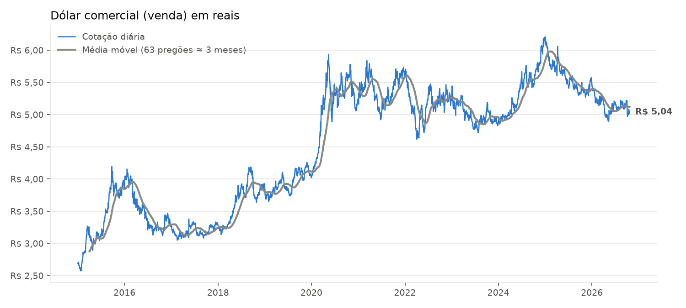
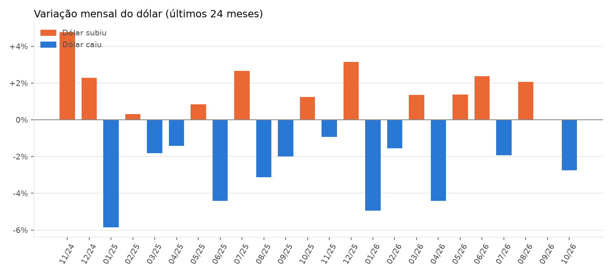

# 💵 Análise da Cotação do Dólar

Pipeline de dados que coleta a cotação histórica do dólar diretamente da **API do Banco Central**, trata os dados com **Python/Pandas** e entrega tabelas prontas para um dashboard no **Power BI**.


-0B3D91?style=flat-square)

## 🎯 Perguntas que o projeto responde

- Como o dólar se comportou nos últimos 10 anos?
- Em quais meses ele mais subiu ou caiu?
- Quais períodos foram mais instáveis (maior volatilidade)?
- Quanto o dólar variou em relação ao mesmo período do ano anterior?

## 📈 Resultados





## 🔄 Como funciona

```
API do Banco Central (SGS, série 1)
        │  coleta.py      → baixa em janelas de até 10 anos (limite da API)
        ▼
dados/bruto/dolar_bruto.csv
        │  tratamento.py  → tipos, duplicados, variação diária, médias móveis
        ▼
dados/tratados/
   ├── cotacao_diaria.csv   (fato)
   ├── resumo_mensal.csv    (agregado mensal)
   └── dim_calendario.csv   (dimensão de datas)
        │
        ├──► Power BI        → modelo estrela + medidas DAX
        └──► visualizacao.py → gráficos deste README
```

**Fonte:** [Sistema Gerenciador de Séries Temporais do Banco Central](https://www3.bcb.gov.br/sgspub/), série 1: *Taxa de câmbio livre, dólar americano (venda), diária*.

## 🚀 Como executar

```bash
git clone https://github.com/pedromeneghelli/analise-cotacao-dolar.git
cd analise-cotacao-dolar
pip install -r requirements.txt

python main.py                       # de 2015 até hoje
python main.py --inicio 2020-01-01   # período personalizado
```

Os CSVs saem com `;` como separador e `,` como decimal, para abrir direto no Excel e no Power BI em português.

Para rodar os testes:

```bash
python -m pytest
```

## 📊 Dashboard no Power BI


O passo a passo do modelo de dados, as medidas DAX e o layout do painel estão em [`powerbi/medidas_dax.md`](powerbi/medidas_dax.md). O arquivo do painel está em [`powerbi/dashboard_dolar.pbix`](powerbi/dashboard_dolar.pbix).

## 📁 Estrutura

```
├── main.py                 # executa o pipeline completo
├── src/
│   ├── coleta.py           # acesso à API do Banco Central
│   ├── tratamento.py       # limpeza e tabelas para o Power BI
│   └── visualizacao.py     # gráficos
├── tests/                  # testes automatizados com pytest
├── dados/                  # gerado pelo pipeline
├── imagens/                # gráficos gerados
└── powerbi/                # guia do dashboard e medidas DAX
```

## 🔜 Próximos passos

- Adicionar euro e outras moedas para comparação
- Cruzar com a taxa Selic e a inflação (IPCA), também disponíveis no SGS
- Agendar a atualização automática dos dados

---

Feito por **Pedro Meneghelli** · [LinkedIn](https://www.linkedin.com/in/pedro-henrique-meneghelli/)
